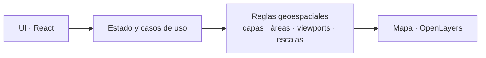
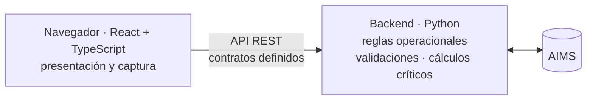

<h1 align="center">Andrés Guerrero</h1>

  <strong>Software Developer</strong> · GIS · Sistemas aeronáuticos · Arquitectura limpia

  Frontend geoespacial con React, TypeScript y OpenLayers. 
  Backend en Python, contratos de API explícitos y reglas de dominio fuera de la interfaz.

  
  

---

## Trabajo actual

| | Proyecto | Dominio | Núcleo técnico |
|---|---|---|---|
| **01** | **Alchemy** | GIS para telecomunicaciones | React · TypeScript · OpenLayers |
| **02** | **Flight Log System** | Registro de vuelo digital integrado con AIMS | React · TypeScript · Python · API REST |

### Alchemy · GIS para planos de obra de telecomunicaciones

Aplicación que convierte información geoespacial en **hojas cartográficas listas para el trabajo técnico**: el terreno se reparte entre hojas, cada una con su viewport y su escala.

**Qué construyo**

- Gestión de **capas y áreas** sobre el mapa.
- Creación y manipulación de **viewports** y control de **escalas**.
- **Distribución del terreno entre hojas** y composición de cada hoja.
- Flujos de UI/UX que reducen operaciones geoespaciales complejas a pasos claros para el usuario.

**Decisión de diseño:** las reglas geoespaciales viven separadas de la interfaz, y el estado de la UI se mantiene predecible.

### Flight Log System · registro de vuelo digital

Digitaliza el registro de vuelo de una operación aérea y se integra con **AIMS** como fuente de información operacional.

**Decisión de diseño:** el backend en **Python** es la frontera autoritativa. La comunicación con AIMS, las validaciones y los cálculos críticos **no dependen del navegador**.

- Reglas operacionales modeladas en el dominio, sin acoplarlas a la interfaz.
- Desarrollo guiado por pruebas (TDD) y diseño por contratos.
- Documentado para su traslado a un equipo de IT: decisiones técnicas, contratos, responsabilidades del backend y criterios de evolución.

> Repositorio privado: es un sistema de dominio operacional.

---

## Proyectos públicos

### [TuttoFatto](https://github.com/Andrz98/ToDoBot) · bot de Telegram para tareas y recordatorios

- Notificaciones programadas con `cron`, persistencia en MongoDB y acceso restringido a usuarios autorizados.
- Código organizado por responsabilidad: `actions`, `controllers`, `events`, `middlewares`, `models`, `services`.
- Calidad automatizada: pruebas con Vitest, ESLint y Prettier.
- Más de **480 commits** de evolución continua.
- Instancia en funcionamiento: [`@tuttofatto_bot`](https://t.me/tuttofatto_bot).

### [Atoms para MQL5](https://github.com/Andrz98/MQL5-InvestBrothers) · librería modular para Expert Advisors

Componentes de trading sin lógica de estrategia, cada uno una clase independiente con interfaz mínima (`.mqh`) e implementación separada (`_impl.mqh`).

| Módulo | Clase | Responsabilidad |
|---|---|---|
| `Flow` | `CNewBarDetector` | Detectar apertura de vela para no evaluar velas en curso |
| `Indicators` | `CMaHandler` | Gestionar una media móvil sobre `iMA()` |
| `Risk` | `CPositionSizer` | Calcular lotes según % de riesgo, stop loss y saldo |
| `Trade` | `COrderManager` | Simplificar órdenes de compra y venta sobre `CTrade` |

Configuración por constructor o `setParams()`, sin variables globales.

---

## Stack

| Área | Tecnologías |
|---|---|
| **Frontend** | TypeScript · JavaScript · React · Vite · Tailwind CSS |
| **Geoespacial** | OpenLayers |
| **Backend** | Python · FastAPI · Node.js · API REST |
| **Datos y automatización** | Python · Microsoft Fabric · MongoDB |
| **Calidad** | Vitest · Testing Library · ESLint · TDD |
| **Herramientas** | Git · GitHub · GitHub Projects (Kanban) |
| **Trading algorítmico** | MQL5 |

---

## Cómo trabajo

- **Dominio primero.** Entiendo el problema y sus reglas antes de elegir herramientas.
- **Fronteras claras.** Frontend, backend, datos e infraestructura no se mezclan; cada contrato es explícito.
- **Las pruebas protegen comportamiento.** No son un trámite.
- **Código legible por otros.** Alguien debe poder leerlo, discutirlo, probarlo y mejorarlo sin reconstruir el sistema entero.
- **Trabajo trazable.** Planifico en [GitHub Projects](https://github.com/users/Andrz98/projects/5/views/1) con Kanban: objetivos divididos en issues y subissues, etiquetas automatizadas y criterios de aceptación ligados a cada entrega.

---

  Conversemos sobre <strong>GIS</strong>, <strong>arquitectura de software</strong>, <strong>sistemas aeronáuticos</strong> o <strong>automatización</strong>.  
  <a href="https://www.linkedin.com/in/andresguerrero-fullstack/">LinkedIn</a> ·
  <a href="mailto:andresdgr2898@gmail.com">Correo</a> ·
  <a href="https://github.com/users/Andrz98/projects/5/views/1">Tablero de proyectos</a>

